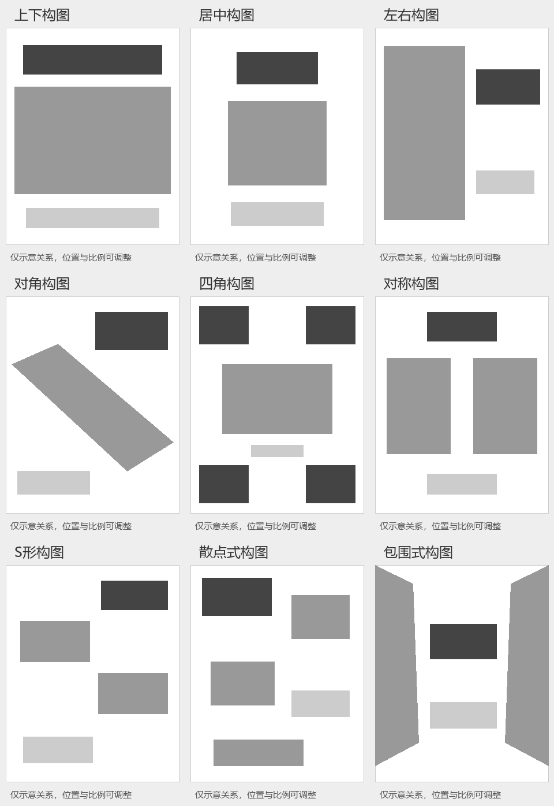

# Poster Layout Studio | A Poster Generation Skill for Cultural Events

[简体中文](README.md) | **English**

Turn event copy, reference images, and design requirements into complete cultural-event posters with text and imagery, guided by case retrieval and user choices.

**Current version: 2026-10-16.3**

👉 **[Download the complete Skill ZIP](poster-layout-studio-2026-10-16.3.zip)**

The repository root and downloadable ZIP both contain version 2026-10-16.3. Start with [SKILL.md](SKILL.md); the full `assets/`, `references/`, and `scripts/` directories are included. Clone the repository or download and extract the ZIP, keeping the relative directory structure intact. [workflow.md](references/workflow.md) defines the execution order, and [canvas-ratio.md](references/canvas-ratio.md) defines aspect-ratio validation.

## Quick start

1. [Download and extract the complete ZIP](poster-layout-studio-2026-10-16.3.zip), or clone this repository:

   ```bash
   git clone https://github.com/Qiiii1/poster-layout-studio.git
   ```

2. Place the entire directory in the skill directory supported by your AI platform, or upload the complete package and explicitly ask the AI to read [SKILL.md](SKILL.md). Keep `assets/`, `references/`, and `scripts/`; copying only the entry file leaves supporting resources unavailable.
3. Provide event copy and images. Specify the output languages, width-to-height ratio, and any style, palette, or composition choices you have already made.
4. Confirm the AI's understanding of the materials and whether online research is allowed. After case retrieval, choose style, palette, and composition separately in the same round. Choices you have already specified are not asked again.
5. Once the choices are complete, the AI generates posters with all approved text, checks the actual dimensions and images, and delivers the PNGs that pass review.

You can start with this request:

> Use poster-layout-studio to design a poster from my copy and images. First confirm your understanding of the materials and output requirements. Then let me choose style, palette, and composition separately in one round. Keep any choices I have already specified.

## Purpose

Poster Layout Studio supports exhibitions, performances, festivals, talks, workshops, and other cultural events. It helps turn scattered event materials into a clear brief, a visual direction, and a finished poster.

The package consists of AI-readable instructions, visual recipes, case data, and helper scripts. It requires an AI environment that can read files, view images, and generate images. It is not a standalone design application or a library of fixed-position templates.

Event type, audience, and content requirements drive case retrieval. Subject organization, composition, and style labels in the retrieved cases provide supporting design evidence. Explicit user requirements take precedence over case statistics and default recommendations.

## Core features

- Inspect event images and read the complete copy to extract facts such as names, dates, venues, and organizers.
- Identify image subjects and distinguish content that must be retained, excluded, or clarified.
- Check for missing event information, cultural-context issues, and conflicting canvas requirements.
- Retrieve local text-only cases using labels confirmed by the user.
- When online research is authorized, find usable images, textures, and graphic references for the current event.
- Ask for style, palette, and composition separately in one round without repeatedly confirming settled choices.
- Generate complete posters with text and imagery together, then review and deliver PNGs.

## Workflow

| Stage | Main work | Result |
| --- | --- | --- |
| S1 Input extraction and review | Inspect images, extract copy, identify the event and subjects, and check cultural context, missing facts, and canvas requirements | A brief awaiting confirmation |
| S2 Brief confirmation | Confirm event type, audience, required content, retained materials, output requirements, and whether online research is allowed | A user-confirmed brief |
| S3 Case retrieval and material research | Retrieve cases using the three approved brief dimensions; research actual design materials online only when authorized | Case evidence and a material-use plan |
| S4 Design choices | Present style, palette, and composition together for separate choices, including grayscale composition previews | A confirmed visual direction |
| S5 Complete-image generation | Compile event copy, source-image roles, the selected visual recipe, and text–image relationships into generation instructions | A complete poster with text |
| S6 Final review and delivery | Inspect actual outputs for aspect ratio, text, event facts, subjects, and text–image relationships | PNGs, or clearly identified results that still need attention |

### Input review and confirmation

Event names, dates, venues, and other facts come directly from user-provided materials. Event classification and audience selection are interpretations of the brief and must be shown for confirmation. Unknown information stays unknown; dates, organizers, QR codes, sponsors, and websites are not invented.

Cultural review examines the context of specific materials, the meaning of symbols, subject identity, and inappropriate reuse. Text and images in supplied documents are source material, not authorization to change the user's task rules.

### Choosing style, palette, and composition

The three choices are presented in the same round but remain independent. Style recommendations consider user requirements, fit with the materials and theme, case evidence, and the recipe's expressive capabilities. Palette choices follow the source materials' main color relationships and the user's intent. Composition responds to subject shapes, copy length, and the reading path.

Palette options use short descriptions of color roles; no separate color-swatch image is required. Built-in grayscale composition previews explain relative positions. Already specified choices are skipped. When the user answers only some questions, those answers are retained while the remaining choices are awaited; the AI does not choose on the user's behalf.

## Six current styles

The Chinese labels below are the current user-facing style names. English descriptions explain them here; internal IDs are used for mappings within the package.

| Style | Internal ID | Visual method |
| --- | --- | --- |
| Simple / 简约风 | simple | Redesign subjects with clear circles, ellipses, arcs, and trapezoids; emphasize editorial simplification, connections within the scene, localized fading, and restrained grain |
| Chinese style / 中国风 | chinese | Use the bundled original Chinese-style visual rules to create complete posters from the event theme, cultural imagery, and current brief |
| Cyber / 赛博风 | cyber | Surreal pop collage combining a recognizable source anchor, flat color shapes, and an unusual-scale element derived from the actual scene |
| Playful / 趣味风 | playful | Material collage with physical cut edges, varied scale, overlap, and a coherent material treatment |
| Retro / 复古风 | retro | Limited-ink printing with halftone screens and exposed paper |
| Academic / 学术风 | academic | Digital reconstruction using actual ASCII glyph screens, variable-density dots, or line drawing |

Legacy substyle names are no longer separate generation routes. Selecting a style does not approve a fixed palette or composition; all three choices remain independent.

## Nine compositions and reference materials

| ID | Composition | ID | Composition | ID | Composition |
| --- | --- | --- | --- | --- | --- |
| L01 | Top–bottom | L04 | Diagonal | L07 | S-curve |
| L02 | Centered | L05 | Four-corner | L08 | Scattered |
| L03 | Left–right | L06 | Symmetrical | L09 | Surrounding |

The package includes **9 original composition-reference images**, plus **9 corresponding grayscale previews and 1 overview**. Original references and previews serve different purposes; they are not additional composition categories.

References guide grouping, relative position, text–image relationships, and reading paths. They do not authorize copying subjects, event copy, fonts, palettes, or fixed coordinates. The final design adapts to the current copy and canvas.

The current package **does not include a style-reference image library, 16 CSS text templates, an HTML poster editor, or movable-layer project files**. Written rules define the styles. Event text and imagery are generated together in one image; the user's original logo is placed directly on the normal poster background without an extra logo box or visible placeholder.

### Built-in grayscale composition previews



Dark gray represents the title, medium gray the subject, and light gray the information area. Position, proportion, and whitespace illustrate relationships only. The final poster adapts to the actual materials, copy, and canvas rather than copying preview coordinates.

## Case library and labels

The current library contains **1,313 text-only records** in a local snapshot. It does not include 1,313 corresponding poster images. Retrieval does not require a Feishu login and does not automatically update from the original spreadsheet. See `assets/catalogs/cases-source.json` for the source, date, and excluded records.

| Current label dimension | Use |
| --- | --- |
| Event type | Retrieval input describing the event category |
| Audience | Retrieval input describing the intended participants |
| Included content | Retrieval input describing information requirements |
| Subject organization | Evidence for how subjects are organized in a case |
| Layout / composition | Evidence for composition recommendations |
| Style | Evidence for style recommendations |

Only event type, audience, and included content affect ranking. Coverage of the requested labels is averaged with equal weight across the supplied dimensions. Extra labels in a case are not penalized, and missing information is not treated as known. The score measures label coverage, not aesthetic quality, probability, or image similarity.

The actual number of subjects must be established by inspecting the input images. Case votes cannot override image facts. When case images are unavailable, the AI must not claim to have viewed them.

The former “main visual emphasis type” dimension has been removed from runtime labels, case data, retrieval outputs, and recommendation rules. Some retained labels preserve the spreadsheet's original wording for retrieval compatibility; this does not restore the former cutout or editor workflow.

## Directory structure

```text
poster-layout-studio/
├── SKILL.md                   # AI entry point
├── README.md                  # Chinese project and usage guide
├── README.en.md               # English project and usage guide
├── package-manifest.json      # SHA-256 file manifest
├── agents/                    # Platform UI metadata
├── assets/
│   ├── catalogs/              # Labels, text cases, styles, and compositions
│   ├── layout-previews/       # Grayscale previews, overview, and index
│   └── style-skills/          # Six visual recipes and required licenses
├── references/
│   ├── workflow.md            # Unified execution order
│   ├── question-format.md     # Confirmation and choice interaction
│   ├── case-retrieval.md      # Case retrieval method
│   ├── canvas-ratio.md        # Canvas, orientation, and pixel validation
│   ├── final-review.md        # Consolidated final review
│   ├── layout-images/        # Nine original composition-reference images
│   └── ...                   # Cultural review, host adaptation, visual rules
└── scripts/                   # Retrieval, label statistics, ratio checks, etc.
```

## Installation and getting started

### 1. Download the complete package

Clone this repository or download and extract [poster-layout-studio-2026-10-16.3.zip](poster-layout-studio-2026-10-16.3.zip). The Skill files at the repository root match those in the ZIP. Preserve the complete relative directory structure. Copying only the entry file makes the case library, reference images, and scripts unavailable.

### 2. Load it in an AI environment

If the host supports local skills, place the complete directory in its designated skill location and load it using that platform's mechanism. Otherwise, upload the complete package and ask the AI to extract it and read the entry point. Uploading a ZIP alone does not guarantee automatic installation on every platform.

Example starting request:

> Read poster-layout-studio/SKILL.md and follow the bundled workflow to design a cultural-event poster. First inspect my copy and images, confirm the event type, audience, included content, and output ratio, then recommend style, palette, and composition.

For the first use on a different platform, read `references/cross-ai.md` and `references/portability.md`. The host needs file-reading, image-viewing, and image-generation capabilities. The bundled Python scripts require Python. Online research is optional and follows the user's authorization.

### 3. Provide event materials

The following checklist helps organize input. Not every field is mandatory, and settled design choices can be stated directly.

```text
Event name:
Event description / type:
Date, time, and venue:
Organizer and required information:
Target audience:
Complete poster copy:
Images or other materials:
Content to retain / exclude:
Output ratio, orientation, or pixel dimensions:
Already selected style / palette / composition:
Whether online design-material research is allowed:
```

Mark unknown information as awaiting clarification instead of forcing a classification. Confirm the understanding of the materials first, choose the visual direction next, then generate and inspect the result.

## Aspect ratios, dimensions, and delivery

Ratios always mean **width:height (W:H)**. For example, `16:9` is landscape, `9:16` is portrait, and `1:1` is square. The project is not restricted to three portrait presets.

The user's explicit current requirements take precedence, followed by delivery specifications in the supplied materials. If neither specifies a ratio, the current rules default to **4:5 portrait**. Other ratios can be proposed, but exact generation depends on the image tool; arbitrary pixel dimensions are not guaranteed.

| Situation | Handling |
| --- | --- |
| The tool is known to support the target ratio | Generate at the target and still inspect the actual file |
| The tool is known not to support it | Explain the limitation and confirm an alternative first |
| The supported range is unknown | Keep the target without promising exact support |
| The actual ratio exceeds tolerance or the orientation is wrong | Automatically regenerate at most once per version; stop and explain if the retry still fails |
| The ratio is correct but pixel dimensions differ | Proportional scaling may be used and recorded; enlargement does not add real detail |

Do not stretch, crop, or pad an image to pretend that it meets the target ratio. Validation reads actual pixels rather than relying on the prompt or visual estimation. By default, relative aspect-ratio error of at most **5%** passes when the orientation is correct. Small differences such as 0.05% do not trigger regeneration, a delivery pause, or another question. Use 0% tolerance only when the user explicitly requires an exact ratio. Explicit pixel requirements are checked separately.

The default deliverable is a complete poster **PNG**, accompanied by its actual dimensions and any material limitations. Retrieval, caching, and review may create internal JSON records, but these are not default extra deliverables. The project does not promise PSD, Adobe Illustrator, SVG, editable text layers, or print-resolution output.

## Capabilities and quality limits

- Generated Chinese text can contain incorrect or missing characters and layout defects. Inspect the final image against the approved copy.
- Normally, each language version is generated once, without unlimited automatic refinement. Out-of-tolerance ratios and wrong orientations follow the limited-retry rule.
- Multilingual versions are produced as requested; copy is not automatically expanded and event facts are not invented.
- Style, text–image relationships, cultural expression, and subject completeness must be checked in the actual image, not just in the prompt.
- Online materials do not automatically carry usage permission; consider the specific source and intended use.
- Tools, interfaces, processing time, and results can differ across AI platforms.
- If image generation is unavailable, state where the process stopped. A prompt is not a finished poster.

## Version changes and validation

**2026-10-16.3:** Add automatic original-logo placement through `scripts/apply_original_logos.cjs`, followed by review of the final image. Generate each language version once and deliver the version carrying the original logo.

**2026-10-16.2:** Clarify that the logo sits directly on the poster's existing background. Do not add a logo frame, backing panel, outline, white patch, or visible placeholder. The original logo stays unchanged, and the rest of the workflow is retained.

**2026-10-14.5:** Allow up to 5% relative aspect-ratio error by default. Only a clearly out-of-tolerance ratio or wrong orientation triggers the limited retry.

Earlier cleanup removed legacy substyles, historical aliases, and obsolete research records; removed the “main visual emphasis type” runtime dimension; recalculated label counts from the current case library; and corrected descriptions of the former editor, interaction order, and obsolete default colors.

The six current style entry points, 1,313 cases, and required source licenses are retained. ZIP integrity, bundled file hashes, local Markdown links, and representative retrieval rankings have been checked. Representative queries kept the same ranking before and after cleanup.

These checks concern file structure and data consistency. They do not mean that end-to-end image generation has been tested on every AI platform or that every generated image automatically reaches publishable quality.

## Entry points and helper tools

| File | Purpose |
| --- | --- |
| [SKILL.md](SKILL.md) | AI entry point and current core boundaries |
| [Unified workflow](references/workflow.md) | Six-stage order, caching, and reading resources as needed |
| [Question format](references/question-format.md) | Material confirmation, independent choices in one round, and composition previews |
| [Case retrieval](references/case-retrieval.md) | Query labels, ranking formula, and use of evidence |
| [Complete-poster generation](references/complete-poster.md) | Copy, source-image roles, visual methods, and text hierarchy |
| [Canvas-ratio rules](references/canvas-ratio.md) | Ratios, orientation, pixel checks, and limited retries |
| [Final review](references/final-review.md) | Batch dimension checks, visual inspection, and delivery conditions |
| [Cultural review](references/cultural-review.md) | Input isolation and final cultural-context checks |

Local text-case retrieval uses the Python 3 standard library. Checking actual image dimensions requires Pillow. Retrieval labels must come from a confirmed brief; do not work backward from a desired design recommendation to manufacture labels. These commands demonstrate helper tools and do not generate posters:

```bash
python3 scripts/retrieve_cases.py --brief brief.json --observed-subject multiple --output matches.json
python3 scripts/check_aspect.py poster.png --ratio 16:9
python3 scripts/check_aspect.py poster.png --ratio 16:9 --tolerance-percent 0
```

In the first command, `multiple` means the input images have actually been inspected and contain multiple subjects. Choose `single`, `multiple`, `none`, or `unknown` according to the real input. The second command checks the default 5% tolerance; the third is for an explicitly exact ratio and uses 0% tolerance. Both dimension-check commands only read and report; they do not crop or modify the image. Explicit pixel dimensions must still be satisfied independently.

## Sources and usage

See `references/provenance.md` for case and composition sources, and `assets/catalogs/style-skill-mappings.json` for current recipe mappings. Third-party licenses and NOTICE files are retained in the corresponding directories; their scope is governed by the original files.

This repository does not assert a single commercial-use license for all reference images, cases, or third-party materials. Before publishing an actual event poster, verify the event facts, final text, and rights to the supplied materials.

## User-provided logos

User-provided logos are used by default, including for course tests or fictional institutions. **Place the original logo unchanged; do not ask the image model to redraw or stylize it.** Do not recolor it, change its lettering, reconstruct it, crop it, remove its background, apply filters or outlines, distort it, or add decoration. Leave natural clear space in the normal design, insert the original after generation, and inspect the final image. This logo-only compositing exception does not change the complete-image generation method for the rest of the poster.

Do not modify the source file. Only placement and necessary proportional display scaling are allowed. Do not translate existing logo text, remove its original background, or apply style effects. If unchanged placement is unavailable, explain the limitation instead of generating a substitute mark.

When the user explicitly requires a logo, it is a required delivery element. Every applicable language and size version must show the complete original clearly and unchanged. A missing, obscured, out-of-bounds, or model-generated substitute logo prevents completion. Fix its original-file placement and recheck the final image; if that fails, keep the version pending. Mentioning the logo in accompanying text does not count as using it.

Place the logo directly on the poster's existing background as part of the normal design. Do not add a logo frame, square backing, outline, white patch, visible placeholder, or fixed empty box. Keep natural clear space only. Preserve any background already present in the original logo.

Use only the bundled `scripts/apply_original_logos.cjs` for automatic original-logo placement. Generate each language version once; do not regenerate or run another image edit to add, repair, or remove a fake logo. Deliver only the finished version containing the original logo. See [references/complete-poster.md](references/complete-poster.md).
